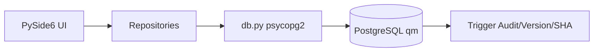

# Anforderungen

### Überblick & Ziele
Ein Desktop-Frontend (Python 3.10+, PySide6) für das Schema `qm` (siehe `project.md`, `SQL/generate_schema.sql`), das die Grundfunktionen abbildet: Themen, Sitzungen inkl. Tagesordnung (Besprechungen), Maßnahmen, Dokumente und Verlauf. Grundlage ist das bestehende Schema, es wird nicht verändert.

### Umfang
**Enthalten (MVP):**
- Login-Dialog für die PostgreSQL-Verbindung (Host, Port, DB, Benutzer, Passwort), Einstellungen werden ohne Passwort gespeichert
- Themen: Liste mit Filter (Status, Kategorie, Freitext), Anlegen/Bearbeiten, Wiederaufnahme mit Pflichtbegründung
- Sitzungen: Liste, Anlegen/Bearbeiten, Teilnehmende, Tagesordnung (Themen zuordnen, TOP-Nr., Status, Ergebnis/Beschluss)
- Maßnahmen: Liste je Thema und als Gesamtübersicht (überfällige hervorgehoben), Anlegen/Bearbeiten, Statuswechsel, Wirksamkeitsprüfung
- Dokumente: Upload (BYTEA), Download/Öffnen, Zuordnung zu Thema/Sitzung/Besprechung/Maßnahme, Anzeige von SHA-256 und Version
- Verlauf: schreibgeschützte Auditansicht je Datensatz (aus `qm.verlauf`)
- Optimistische Sperre über die Spalte `version`

**Nicht enthalten:** Rollenabhängige Oberfläche/RLS, Berichte/Exporte, Volltextsuche, Freigabe-Workflow für Dokumente über einen einfachen Statuswechsel hinaus, EPZ-Validierung (`epz_fall_id` nur als Freitext).

### User Stories
- Als QM-Mitarbeiter möchte ich Themen erfassen und filtern, damit ich offene Sachverhalte im Blick habe.
- Als Protokollführung möchte ich eine Sitzung mit Tagesordnung und Beschlüssen dokumentieren.
- Als Verantwortlicher möchte ich fällige Maßnahmen sehen und ihren Status fortschreiben.
- Als Prüfer möchte ich die Änderungshistorie eines Datensatzes nachvollziehen können.

### Funktionale Anforderungen
- Statuswerte in Comboboxen entsprechen exakt den CHECK-Constraints.
- Speichern mit `UPDATE ... WHERE id=%s AND version=%s`; 0 betroffene Zeilen → Hinweis „Datensatz wurde zwischenzeitlich geändert“ und Neuladen.
- `erstellt_von`/`geaendert_von` = angemeldeter DB-Benutzer.
- Datenbankfehler (Constraint-Verletzungen) werden als verständliche Meldung angezeigt.

### Nicht-funktionale Anforderungen
- Kompatibel mit PostgreSQL 10.10, lauffähig unter Windows 64-Bit.
- Kein ORM-Schemamanagement; das SQL-Schema bleibt maßgeblich.

# Technische Konzeption

### Ausgangslage
Das Repository enthält nur Planung, Dokumentation und `SQL/`. Trigger übernehmen bereits Versionierung, Zeitstempel, Prüfsumme, Dateigröße und Audit — das Frontend muss diese Logik nicht nachbauen.

### Zentrale Entscheidungen
- **DB-Zugriff:** `psycopg2-binary` mit handgeschriebenem SQL in einer schlanken Repository-Schicht (kein SQLAlchemy) – direkt, transparent, PG10-sicher.
- **Schichten:** `db` (Verbindung) → `repositories` (SQL je Entität, gibt Dataclasses zurück) → `ui` (Widgets/Dialoge). Keine SQL-Anweisungen in den Widgets.
- **Tabellen:** `QAbstractTableModel` + `QSortFilterProxyModel` für Listen und clientseitige Filterung.
- **Navigation:** `QMainWindow` mit Seitenleiste (Themen, Sitzungen, Maßnahmen, Dokumente) und `QStackedWidget`; Bearbeitung in modalen Dialogen bzw. Detailansichten mit Tabs (Stammdaten, Maßnahmen, Dokumente, Verlauf).
- **Begründungen im Audit:** `qm.verlauf.begruendung` wird nicht durch Trigger befüllt; im MVP wird die Begründung in `wiederaufnahme_grund` bzw. `massnahme.begruendung` gespeichert (dadurch im JSONB-Snapshot enthalten).
- **Wiederaufnahme:** Im MVP wird derselbe Datensatz auf `wiederaufgenommen` gesetzt (Felder `wiederaufnahme_*`); Folgedatensatz via `vorgaenger_thema_id` als optionale Aktion.

### Dateistruktur (neu)
```
frontend/
  requirements.txt          # PySide6, psycopg2-binary
  main.py                   # Einstiegspunkt
  qm_app/
    config.py               # QSettings-Verbindungsprofil
    db.py                   # Verbindung, Transaktions-Kontextmanager, Fehlerübersetzung
    models.py               # Dataclasses + Statuskonstanten
    repositories/
      thema_repo.py  sitzung_repo.py  besprechung_repo.py
      massnahme_repo.py  dokument_repo.py  verlauf_repo.py
    ui/
      main_window.py  login_dialog.py  table_model.py
      thema_view.py   thema_dialog.py
      sitzung_view.py sitzung_dialog.py  agenda_widget.py
      massnahme_view.py massnahme_dialog.py
      dokument_widget.py verlauf_widget.py
  tests/                    # pytest gegen Test-DB
```

### Verträge (Beispiel)
```python
class ThemaRepository:
    def list(self, status=None, kategorie=None, text=None) -> list[Thema]: ...
    def get(self, id: UUID) -> Thema: ...
    def create(self, t: Thema, user: str) -> UUID: ...
    def update(self, t: Thema, user: str) -> None  # raises ConcurrencyError
    def reopen(self, id, version, grund, user) -> None
```
Dokument-Upload: `INSERT INTO qm.dokument(dateiname, mime_type, inhalt, dokumenttyp, erstellt_von) VALUES (..., psycopg2.Binary(data), ...)` plus Zuordnungszeile in derselben Transaktion; Liste lädt `inhalt` nicht mit.

### Architektur


### Risiken
- Dokumente (v. a. Word, wenige MB) werden synchron mit Wartecursor übertragen; Listen laden `inhalt` nie mit. Konfigurierbares Größenlimit (Standard 25 MB) als Schutz; Hintergrund-Thread bei Bedarf später nachrüstbar.
- Trigger-Benutzer im Audit = `erstellt_von`/`geaendert_von` bzw. `current_user` → konsistent befüllen.

# Tests

### Vorgehen
- pytest-Tests der Repositories gegen eine Test-Datenbank (Schema aus `SQL/generate_schema.sql`), Verbindungsdaten per Umgebungsvariable; ohne DB werden sie übersprungen.
- UI-Smoke-Test mit `QT_QPA_PLATFORM=offscreen`: Hauptfenster und Dialoge lassen sich instanziieren.

### Zentrale Szenarien
- Thema anlegen → erscheint in Liste, Eintrag in `qm.verlauf`.
- Sitzung anlegen, Thema als TOP zuordnen, Beschluss speichern, daraus Maßnahme erzeugen.
- Dokument hochladen → `dateigroesse` und Prüfsumme gesetzt; Download liefert identische Bytes.

### Randfälle
- Paralleles Update mit veralteter `version` → `ConcurrencyError`.
- Doppelte Zuordnung Thema/Sitzung → verständliche Fehlermeldung (UNIQUE).
- Löschen freigegebener Dokumente wird abgewiesen.

# Delivery Steps

###   Step 1: Projektgerüst, DB-Schicht und Login
Die App startet, verbindet sich nach Login mit PostgreSQL und zeigt das leere Hauptfenster mit Navigation.
- `frontend/requirements.txt`, `main.py`, `qm_app/config.py`, `db.py` (Transaktionen, Fehlerübersetzung, `ConcurrencyError`)
- `models.py` mit Dataclasses und Statuskonstanten gemäß CHECK-Constraints
- `login_dialog.py`, `main_window.py` mit Seitenleiste und `QStackedWidget`, generisches `table_model.py`
- UI-Smoke-Test offscreen

###   Step 2: Themenverwaltung mit Verlaufsansicht
Themen können gelistet, gefiltert, angelegt, bearbeitet und wiederaufgenommen werden; Verlauf ist sichtbar.
- `thema_repo.py`, `verlauf_repo.py`
- `thema_view.py` (Filter Status/Kategorie/Text), `thema_dialog.py` mit optimistischer Sperre
- Wiederaufnahme-Dialog mit Pflichtbegründung
- `verlauf_widget.py` (JSONB alt/neu)
- Repository-Tests inkl. Versionskonflikt

###   Step 3: Sitzungen, Teilnehmende und Tagesordnung
Sitzungen lassen sich mit Teilnehmenden und Besprechungspunkten pflegen.
- `sitzung_repo.py`, `besprechung_repo.py`
- `sitzung_view.py`, `sitzung_dialog.py` mit Teilnehmer-Tab
- `agenda_widget.py`: Thema zuordnen, TOP-Nr., Reihenfolge, Status, Ergebnis/Beschluss, Vertagung
- Tests inkl. UNIQUE-Verletzung

###   Step 4: Maßnahmenverfolgung
Maßnahmen sind je Thema und als Gesamtübersicht mit Fälligkeiten pflegbar.
- `massnahme_repo.py`
- `massnahme_view.py` (überfällige hervorgehoben, Filter Status/Verantwortlich)
- `massnahme_dialog.py` mit Statuswechsel, Begründung, Wirksamkeitsprüfung; Anlage aus Besprechung heraus
- Maßnahmen-Tab in der Themendetailansicht, Tests

###   Step 5: Dokumentenverwaltung
Dokumente können hochgeladen, zugeordnet, geöffnet und versioniert werden.
- `dokument_repo.py` (Upload + Zuordnung in einer Transaktion, Liste ohne `inhalt`)
- `dokument_widget.py` als wiederverwendbarer Tab für Thema/Sitzung/Besprechung/Maßnahme
- Upload/Download synchron mit Wartecursor und konfigurierbarem Größenlimit (Standard 25 MB), neue Version über `dokument_gruppe_id`/`vorgaenger_dokument_id`
- Tests: Prüfsumme, Byte-Gleichheit, Löschschutz